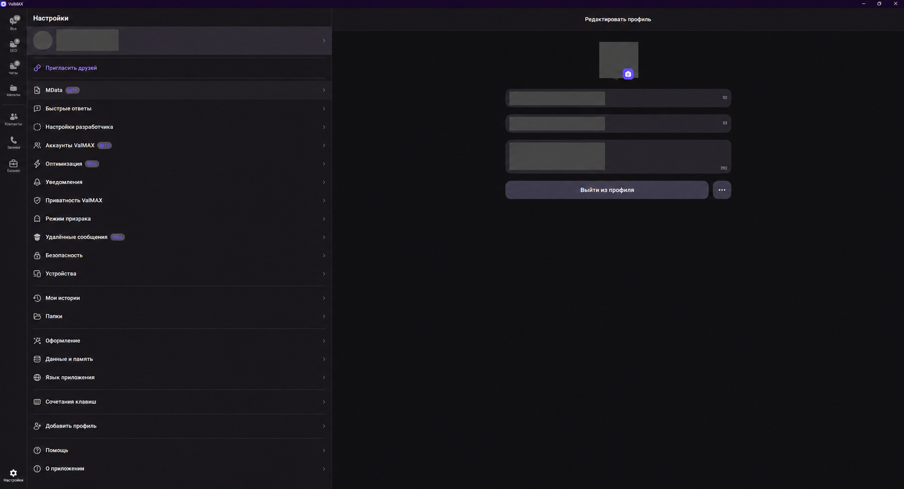

<strong>Ваше общение. Ваши правила.</strong>

<small>Настройки ValMAX. Имя, номер телефона и фотографии скрыты.</small>

# ValMAX — мод MAX для Windows

Неофициальная модификация MAX (МАКС) для Windows x64 с дополнительными возможностями для общения и работы. **ValMAX 8.8.2 Beta**, база — **MAX 26.35.1.80662**.

**ВАЛ** — **В**озможности · **А**втоматизация · **Л**ичный контроль.

[English](README.en.md)

## Для работы с клиентами

**Ближе к клиентам. Свободнее в работе.**

| Возможность | Что она даёт |
| --- | --- |
| До трёх аккаунтов · BETA | Телефонные профили с локальными названиями, цветами и отдельным расписанием уведомлений. |
| Быстрые ответы | Шаблоны по `/команде`: общие или для одного аккаунта, с несколькими сообщениями и вложениями. Отправка ручная. |
| Бизнес-кабинет | Официальный [business.max.ru](https://business.max.ru/) в отдельной вкладке ValMAX. Вход самостоятельный, слот телефонного аккаунта не занят. |
| Экспорт чата · BETA | HTML-копия переписки с доступными вложениями, которую можно открыть без MAX и интернета. |
| MData · BETA | Компактный перенос авторизованной сессии одного или всех своих аккаунтов, включая нужные ключи MAX из Windows. |

## Другие возможности

- **Режим призрака.** Переключатели фильтров набора текста, прочтения сообщений, онлайна и просмотров историй. По умолчанию выключен.
- **Удалённые сообщения · BETA.** Сохранение уже полученных сообщений при наблюдаемом удалении с отметкой в истории. По умолчанию выключено.
- **PIN-код чата.** Локальное ограничение доступа к выбранному чату и скрытие его превью.
- **Приватность.** Отключение проверенных модулей диагностики и статистики, маскировка журналов.
- **Поиск медиа.** `@pic запрос` и `@vid запрос` ищут изображения и видео в Wikimedia Commons по кнопке «Найти». Автор, лицензия и ссылка добавляются в черновик вместе с файлом.
- **Оптимизация · BETA.** Настройки загрузки списков, кэша, фотографий и фоновой работы вкладок. Применяются после полного перезапуска.
- **Встроенный интерфейс.** Настройки разработчика и иконки дополнительных функций в стиле MAX.
- **Помощь и диагностика.** Просмотр и сохранение технического JSON-отчёта для сообщения об ошибке. Отправка вручную.

## Установка

1. [Скачайте установщик ValMAX 8.8.2 Beta для Windows x64](https://github.com/govpodi/max-mod-valmax/releases/download/v8.8.2/ValMAX-26.35.1-Setup.exe) из GitHub Releases. [Контрольные суммы SHA-256](https://github.com/govpodi/max-mod-valmax/releases/download/v8.8.2/SHA256SUMS.txt).
2. Если предыдущая версия работает, закройте её: значок в трее → «Выход».
3. Запустите установщик, затем откройте ValMAX через созданный ярлык. Python отдельно не нужен. Первый запуск может занять до минуты.

[Все выпуски](https://github.com/govpodi/max-mod-valmax/releases)

О BETA и данных

Метки **BETA** означают, что функция ещё тестируется. Подробная инструкция входит в установщик.

- При выборе быстрого ответа вложения сразу добавляются в черновик и могут начать загружаться до нажатия «Отправить». Отправка быстрых ответов и найденных медиа остаётся ручной.
- MData не содержит переписку, медиа, кэш и пароль 2FA. Сервер может потребовать повторную проверку входа. Храните архив MData и его пароль отдельно.
- PIN ограничивает доступ локально, не шифрует базу сообщений и не закрывает ранее открытые окна медиа. HTML-копия чата не защищена паролем; недоступные вложения и неполная история отмечаются в отчёте экспорта.
- Настройки приватности не обеспечивают полную анонимность: сервер получает адрес подключения и данные, необходимые для работы аккаунта. Режим призрака показывает активный статус после подтверждения фильтров клиентом.
- Локальная поправка счётчика непрочитанных в режиме призрака — BETA, действует в текущем запуске. При перезапуске, удалении сообщений или изменении отметок с другого устройства счётчик может снова показывать серверный остаток. Полная повторная синхронизация ещё требует проверки.
- ValMAX использует отдельный профиль от официального MAX. При обновлении старой модифицированной сборки данные MXMOD сохраняются. Штатное автообновление MAX отключено; новые сборки доступны в GitHub Releases.
- ValMAX не связан с командой MAX. Программа не подписана сертификатом разработчика ValMAX; Windows может показать предупреждение при запуске.

## Связь и участие

[Связаться с разработчиком в Telegram](https://t.me/VALMAX_dev) · [Канал ValMAX](https://t.me/VALMAX_github)

Нашли ошибку или хотите предложить функцию? [Как сообщить и что приложить](CONTRIBUTING.md).

Собственный код ValMAX распространяется по MIT; права на MAX и сторонние компоненты принадлежат их правообладателям.

[Лицензия](LICENSE) · [Сторонние компоненты](THIRD_PARTY_NOTICES.md) · [Участие](CONTRIBUTING.md) · [Безопасность](SECURITY.md)
